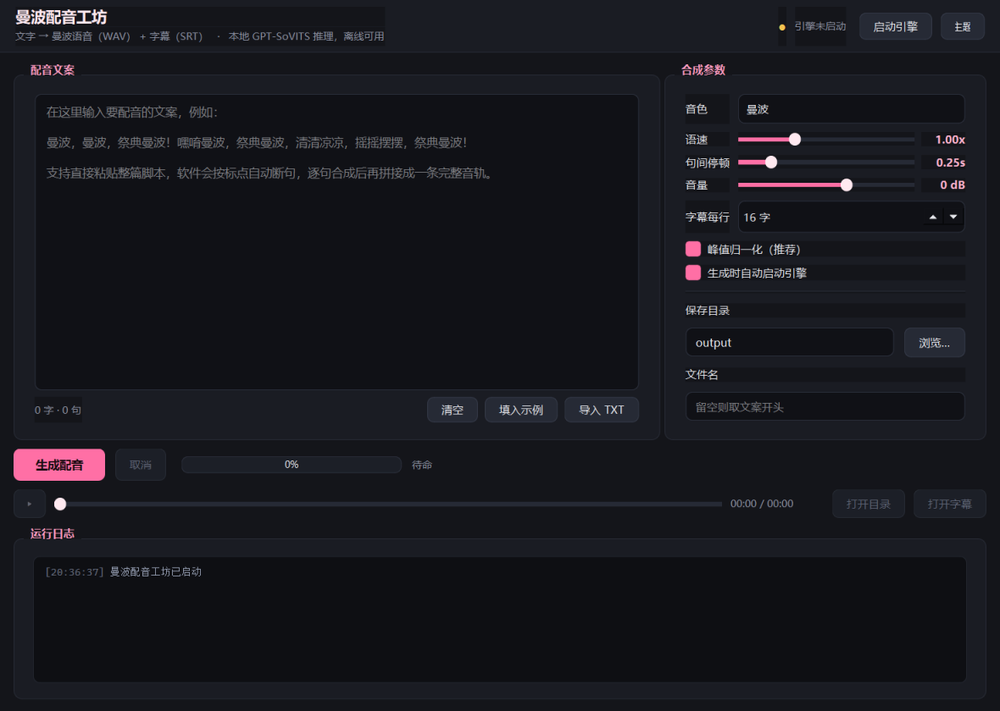

# 曼波配音工坊

输入文字，一键输出 **曼波配音（WAV）** 和 **字幕（SRT）**。

本地 GPU 推理，不调用任何在线语音 API，断网也能用（引擎首次安装需联网下载）。



---

## 功能

| 功能 | 说明 |
| --- | --- |
| 文字转曼波语音 | 输入任意中文文案，逐句合成后拼接为一条完整 WAV |
| 自动生成 SRT | 按句自动打轴，可设置单行字幕字数 |
| 长文自动断句 | 按标点切分，超长句自动二次切分，规避单次合成长度上限 |
| 语速调节 | 0.10x – 3.00x 连续可调，引擎原生变速不变调 |
| 句间停顿 | 0 – 1.5 秒可调，让解说更有节奏 |
| 音量 / 归一化 | -20 – +12 dB 增益，可选峰值归一化到 -1 dBFS |
| 试听 | 内置播放器，带进度条拖动 |
| 深浅主题 | 一键切换，记忆上次选择 |
| 拖入 TXT | 直接把文案文件拖进文本框 |

## 硬件要求

| 显卡 | 能用吗 | 用哪个整合包 |
| --- | --- | --- |
| RTX 50 系（5070 / 5080 / 5090 …） | ✅ 推荐 | `nvidia50` 专用包（CUDA 12.8 / Blackwell） |
| RTX 30 / 40 系及其他 NVIDIA 显卡 | ✅ 可用 | 通用包 |
| 没有 NVIDIA 显卡（AMD / 核显） | ⚠️ 能跑，但很慢 | 通用包 + CPU 推理 |

**不用手动挑包**：`安装引擎.bat` 会读 `nvidia-smi` 自动识别显卡型号并下载对应整合包。
需要强制指定时：`python tools\download_engine.py --general` 或 `--nvidia50`。

- 显存：12GB 舒适，8GB 可用，6GB 会紧张（模型常驻约 2.5GB，推理峰值 5GB 左右）
- 内存：建议 16GB
- 磁盘：引擎解压后约 14GB，安装时另需 8.2GB 整合包（装完自动删除）
- CPU 模式：能出结果，但合成速度比 GPU 慢 20–50 倍，一段 100 字配音要等好几分钟

## 软件依赖（需要自己安装）

本软件**不是打包好的 exe**，只提供源码和脚本。下面两样必须由你自己的电脑装好：

| 依赖 | 为什么需要 | 怎么装 |
| --- | --- | --- |
| **Python 3.10+** | 软件本体、安装向导、启动脚本全是 Python 写的 | 去 [python.org](https://www.python.org/downloads/) 下载安装，**安装第一屏务必勾选 `Add python.exe to PATH`**，并保留默认勾选的 `tcl/tk and IDLE`（安装向导要用 tkinter）。PySide6 6.12 支持 Python 3.10–3.15 |
| **7-Zip** | 引擎整合包是 8.2GB 的 `.7z`，软件自己不负责解压 | 去 [7-zip.org](https://www.7-zip.org/download.html) 下载安装，**建议用默认路径**（`C:\Program Files\7-Zip`），安装向导会自动找到它 |

装好 Python 之后，`PySide6 / requests / numpy` 这些 Python 库**不用手动装**：
`启动.bat` 和 `安装引擎.bat` 会自动用清华镜像 `pip install`。

> 没有装 7-Zip 的话，`安装引擎.bat` 的向导在欢迎页就会标红提醒，下载完 8.2GB 后会在解压那一步失败。
> 如果你更习惯免安装的 7zr，也可以把 `7zr.exe` 手动放进 `tools/` 目录代替。

### 分享给别人怎么用

引擎有 14GB，**不随软件包分发**，由对方机器自己装：

1. 把整个软件文件夹打包发给对方（约 230MB，主要是音色模型）
2. 对方装好 **Python 3.10+** 和 **7-Zip**（见上面的「软件依赖」），双击 `安装引擎.bat`
3. 弹出**安装向导**：先显示检测到的显卡与要下载的整合包，再让对方自己选安装目录（默认推荐空间足够的盘），下载与解压都有实时进度
4. 装完双击 `启动.bat`

引擎路径会写进 `config.json` 的 `engine_dir`，软件按它找引擎；对方机器没有 F 盘也能正常装。

## 快速开始

### 方式一：让 AI Agent 全自动安装

如果你在用 Claude Code / Cursor / Codex / DSH 这类 Agent，**连下载都不用自己动手**——
把仓库链接和安装目录丢给它就行：

> 帮我安装这个项目：https://github.com/Suedonmalus/manbo-voice-studio
> 请按仓库里的 `AGENT_INSTALL.md` 执行，装到 `D:/MamboVoiceEngine/GPT-SoVITS`

Agent 会自己拉代码、装 Python 和 7-Zip、下载 8.2GB 引擎、取音色模型，最后按验收标准自检。
完整手册见 **[AGENT_INSTALL.md](AGENT_INSTALL.md)**。

### 方式二：手动安装

#### 已经装好引擎的话（本机已装）

双击 **`启动.bat`** 即可（前提是 Python 和 7-Zip 已经按上面的「软件依赖」装好）。

#### 全新环境

1. 装好 **Python 3.10+** 和 **7-Zip**（详见上面「软件依赖」；Python 安装时务必勾选 `Add python.exe to PATH`）
2. 双击 **`安装引擎.bat`** —— 弹出安装向导：先显示显卡与要下载的整合包，再**由你决定装到哪个盘哪个目录**（默认推荐空间足够的盘），然后下载 GPT-SoVITS v2Pro 整合包（约 8.2GB，支持断点续传）并显示进度
3. 把音色模型放进 `models/` —— 仓库不含模型文件（体积与版权原因），获取方式见 **[models/README.md](models/README.md)**
4. 双击 **`启动.bat`**

> 安装目录必须是**纯英文路径**，且至少留出 32GB 空间。
> 向导会拒绝装到已有文件的非空目录，避免覆盖你的数据。

> 引擎必须放在**纯英文路径**下（GPT-SoVITS 对中文路径敏感，会加载失败）。
>
> `config.json` 是本地配置（含本机绝对路径），不在仓库内。首次启动自动生成默认值；
> 引擎装在别处时，改 `config.json` 里的 `engine_dir` 即可。

## 使用

1. 在左侧输入或粘贴文案
2. 右侧调参数：语速、句间停顿、字幕每行字数、保存目录、文件名
3. 点 **生成配音**
4. 完成后自动加载到播放器，可直接试听；`打开目录` / `打开字幕` 直达产物

产物命名：`<文件名>.wav` + `<文件名>.srt`。文件名留空则取文案前 18 个字。

### 长文案（几百字、几千字）怎么处理

**「单句上限 60 字」只是断句上限，不是整篇上限。** 整篇文案多长都可以直接粘进来：

- 先按换行、句末标点把文案切成一句一句（每句不超过 60 字）
- 每句单独送进引擎合成，再按顺序拼接成一条完整音轨
- 字幕按同一批句子打轴，时间轴与你听到的音频逐句对应

实测：478 字故事文案 → 切成 16 句 → 输出 **1 分 46 秒**音频 + 45 条字幕，耗时 21 秒（模型已加载的前提下）。

没有标点的长段落也不会卡住，会自动按 60 字硬切。字数越多等待越久（约每 100 字 4–6 秒），中途可随时点「取消」。

## 参数说明

| 参数 | 默认 | 说明 |
| --- | --- | --- |
| 语速 | 1.00x | 低于 1 更慢更清晰，高于 1 更紧凑 |
| 句间停顿 | 0.25s | 句与句之间的静音时长 |
| 音量 | 0 dB | 整体增益 |
| 字幕每行 | 16 字 | 超过则按标点+字数二次切分，时间按字符比例分配；设 0 则整句一行 |
| 峰值归一化 | 开 | 把整条音频峰值压到 -1 dBFS，避免忽大忽小 |

> 字幕采用**句级时间轴**：每句的起止时间由实际合成音频长度决定，是准确的。
> 单句被拆成多行时，句内各行按字符数比例分配时间（这是唯一近似的地方）。

## 目录结构

```
曼波语音生成软件/
├─ 启动.bat                 # 启动软件（自动装依赖）
├─ 安装引擎.bat             # 一键安装 GPT-SoVITS 引擎（打开图形安装向导）
├─ 卸载.bat                 # 卸载引擎与安装痕迹（打开图形卸载向导）
├─ AGENT_INSTALL.md         # 给 AI Agent 的全自动安装手册
├─ app.py                   # 程序入口
├─ core/
│  ├─ segmenter.py          # 文本断句
│  ├─ audio.py              # WAV 读取 / 重采样 / 拼接 / 归一化
│  ├─ srt.py                # SRT 生成
│  ├─ engine_client.py      # 引擎 HTTP 客户端
│  ├─ engine_manager.py     # 引擎进程管理
│  ├─ synthesizer.py        # 合成流水线
│  └─ config.py             # 配置与音色发现
├─ ui/
│  ├─ main_window.py        # 主界面
│  └─ theme.py              # 深/浅主题
├─ models/                  # 音色模型（不在仓库内，见 models/README.md）
│  ├─ manbo_e8_s168.pth     # SoVITS 声学模型（需自行获取）
│  ├─ manbo-e10.ckpt        # GPT 模型（需自行获取）
│  └─ refer.wav             # 参考音频（需自行获取）
├─ tools/
│  ├─ install_wizard.py     # 图形安装向导（双击 安装引擎.bat 打开）
│  ├─ agent_install.py      # 非交互全自动安装器（给 AI Agent 用）
│  ├─ uninstall.py          # 卸载器（GUI + 命令行/Agent 模式）
│  ├─ download_engine.py    # 多源下载器（测速 + 断点续传）
│  └─ install_engine_local.py # 解压安装
├─ engine_temp/             # 整合包临时目录（可删）
├─ output/                  # 默认输出目录
└─ logs/engine.log          # 引擎运行日志
```

引擎本体：`F:\MamboVoiceEngine\GPT-SoVITS`（约 18GB，独立于本目录）。

## 技术架构

```
文案 → 断句(core.segmenter)
     → 逐句 POST http://127.0.0.1:9880/  (GPT-SoVITS api.py)
     → 每句 WAV → 重采样统一 → 插入静音 → 拼接(numpy)
     → 峰值归一化 → 写 WAV
     → 按每句实际时长生成 SRT 时间轴
```

- 引擎：GPT-SoVITS v2Pro（Python 3.9 便携运行时，torch 2.7.0+cu128）
- 客户端：Python 3.13 + PySide6 6.12
- 显存占用约 2–3 GB，RTX 5070 上实时率约 0.5（10 秒音频 ≈ 5 秒合成）

## 卸载

双击 **`卸载.bat`**，会弹出卸载向导：

- 列出安装时创建的全部内容（引擎约 14GB、参考音频副本、引擎日志、下载缓存、音色模型），并显示各自大小
- 可以勾选是否一并删除音色模型（约 230MB）和 `tools/7zr.exe`
- 二次确认后删除，并清空 `config.json` 里的 `engine_dir`

**不会删除**：`output/` 里你生成的音频和字幕、项目源码、系统里 pip 装的 Python 库。

命令行 / 给 Agent 用：

```bash
python tools/uninstall.py --dry-run    # 只列出会删什么，不动手
python tools/uninstall.py --yes        # 跳过确认直接卸载
```

> 卸载前请先关闭曼波配音工坊——引擎还在跑的时候文件被占用，会删不掉。
> 只想重装引擎的话不用卸载，再运行一次 `安装引擎.bat` 就行。

## 常见问题

**Q：提示「引擎未安装」**
先双击 `安装引擎.bat`。若整合包已下载，只是解压失败，可手动把 `.7z` 放进 `engine_temp/` 后重跑安装脚本（会跳过下载）。

**Q：提示「引擎启动超时」**
首次加载模型需要 20–60 秒，属正常。若持续失败，看 `logs/engine.log` 末尾；常见原因是显存不足或显卡驱动过旧。

**Q：字幕时间轴准吗？**
每句起止时间由该句真实音频长度累加得出，是准确的。只有"一句被拆成多行字幕"时，行内时间是按字数比例估算的。

**Q：能换别的音色吗？**
把任意 GPT-SoVITS 音色模型按 `<名字>_e<epoch>_s<step>.pth` + `<名字>-e<epoch>.ckpt` + 同名参考音频放进 `models/`，重启软件就会出现在音色下拉框。

**Q：安装时能自己选目录吗？**
能。双击 `安装引擎.bat` 会先弹出安装向导，默认推荐剩余空间足够的盘，也可以点「浏览…」自己选，或点「F 盘 / D 盘」快速填写。
目录必须是**纯英文路径**，且至少留出 32GB；选到已有文件的非空目录会被拒绝，避免覆盖你的数据。

**Q：提示找不到 python / 双击 bat 闪一下就没反应？**
本软件不是打包好的 exe，依赖系统里的 Python。去 [python.org](https://www.python.org/downloads/) 装 3.10 或更高版本，
安装第一屏务必勾选 **Add python.exe to PATH**（并保留默认的 `tcl/tk and IDLE`，安装向导要用 tkinter），装完重新双击即可。

**Q：提示找不到 7-Zip？**
引擎整合包是 8.2GB 的 `.7z`，软件自身不解压，需要系统里的 7-Zip。
去 [7-zip.org](https://www.7-zip.org/download.html) 下载安装（用默认路径 `C:\Program Files\7-Zip` 最省事），装完重新双击 `安装引擎.bat`。
也可以把 `7zr.exe` 手动放进 `tools/` 目录代替。

**Q：中文路径报错？**
引擎目录必须全英文。参考音频如果放在中文路径，软件会自动复制一份到 `F:\MamboVoiceEngine\voices\` 再给引擎。

## 致谢与许可

- 推理引擎：[RVC-Boss/GPT-SoVITS](https://github.com/RVC-Boss/GPT-SoVITS)
- 曼波音色模型与参考音频：[Tsukimisaka/MamboTTS](https://github.com/Tsukimisaka/MamboTTS)（MIT）
- 「曼波」音源出自《赛马娘 Pretty Derby》待兼诗歌剧相关梗，版权归原权利方

软件本体 MIT。生成音频仅限个人学习、技术研究与创作使用；请勿用于诈骗、仿冒或侵犯他人声音权/肖像权的场景。
